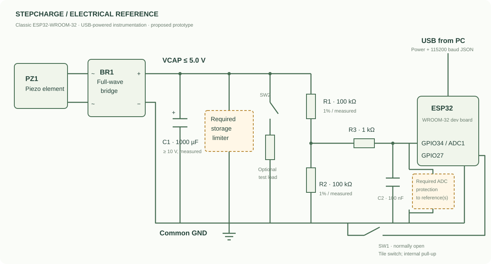
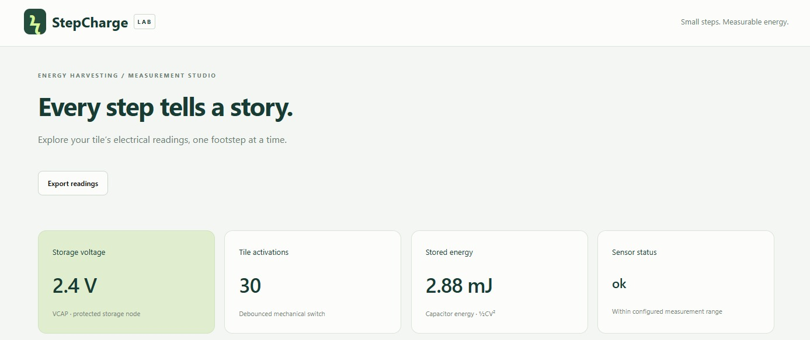
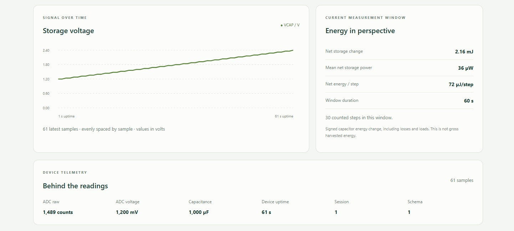
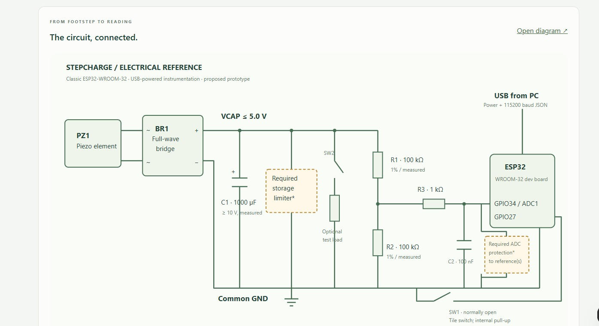

# StepCharge

**ESP32 instrumentation for piezoelectric footstep energy harvesting.**

StepCharge is an engineering reference project for investigating how mechanical footstep loading can be converted into electrical energy, rectified, and accumulated in a capacitor. An independently USB-powered ESP32 measures the storage node and counts tile activations. Python tools capture telemetry and calculate signed net energy change over a trial.

**Status:** proposed prototype reference implementation, not a recovered copy of the earlier project. No physical tile performance, power yield, battery charging, or self-powered operation is claimed. See [validation status](docs/VALIDATION.md).

## Capabilities

- Classic ESP32-WROOM-32 development board firmware; Arduino IDE and PlatformIO project layouts.
- Calibratable storage-voltage sensing on ADC1 GPIO34, with range diagnostics.
- Debounced, release-to-rearm step counting on GPIO27 using a separate mechanical switch.
- Timestamped JSON Lines telemetry at 115200 baud; no Wi-Fi credentials or cloud account required.
- Capacitor energy analysis, mean net storage power, and net energy per counted step.
- Serial capture, synthetic example data, automated analysis tests, and GitHub CI.
- Hardware architecture, component selection requirements, wiring, calibration, and test procedures.

## Architecture



The diagram follows the proposed wiring below; dashed protection blocks require component selection and bench validation. See [hardware details](docs/HARDWARE.md).

## Readings app

**Quick start (no installation):** download or clone this repository and open `app/StepCharge.html` in your browser. The dashboard, circuit diagram, styles, and code are bundled into this file. The final toolbar contains only **Export readings**.

For source development:

Run `node app/serve.mjs` (Node.js 20+) and open **http://localhost:8080/app/**.

The dashboard displays all firmware fields, a voltage chart, and signed net-energy metrics. It opens with a generated 60-second capture: **2.4 V**, **30 steps**, **2.88 mJ stored energy**, and **36 µW mean net storage power**. These are illustrative data, not measured hardware performance. Source badges and acquisition controls are hidden in the final interface; use the Python tools below for real hardware capture. See [app setup and usage](docs/APP.md).

### Interface screenshots







Screenshots supplied by the project owner. They show the generated capture. The [current circuit SVG](docs/circuit.svg) is the editable diagram source.

## Signal path

```text
Mechanical tile / load spreader / travel stops
               |
       Piezoelectric transducer(s)
               |
    Rectification + voltage limiting
               |
      Storage capacitor ---- optional switched test load
               |
      Divider + input protection ---- GPIO34 ADC1

Independent tile switch ------------ GPIO27
USB 5 V --> ESP32 board --> serial JSON --> capture.py --> analyze.py
```

The mechanical switch counts tile activations independently of piezo ringing. The ESP32 is instrumentation, not part of the harvested load. All low-voltage measurement grounds are common. Read [HARDWARE.md](docs/HARDWARE.md) before making connections; raw piezo terminals must never connect directly to an ESP32 pin.

## Repository structure

| Path | Purpose |
|---|---|
| `firmware/StepCharge/` | Arduino sketch and hardware/calibration configuration |
| `platformio.ini` | Alternative PlatformIO build for `esp32dev` |
| `tools/` | USB serial logging and offline energy analysis |
| `app/` | Standalone readings dashboard, export, source modules and bundler |
| `tests/` | Calculation and invalid-capture tests |
| `examples/` | Explicitly synthetic test data, not measured performance |
| `docs/` | Hardware, methodology, validation, references, and upload guide |
| `.github/workflows/` | Automated JavaScript/Python tests and PlatformIO firmware build |

## Build and flash: Arduino IDE

1. Install Arduino IDE and the **esp32 by Espressif Systems** board package.
2. Open `firmware/StepCharge/StepCharge.ino`. Keep `config.h` alongside it.
3. Select **ESP32 Dev Module** and the board's USB serial port. This pin map is for classic ESP32, not ESP32-C3/S3.
4. Read the hardware guide and configure `config.h`. `CAPACITANCE_F` must be the measured storage capacitance in farads. For a nominal 1000 microfarad capacitor, the nominal starting value is `0.001`; measure it for quantitative results.
5. Verify and upload. Open Serial Monitor at **115200 baud**.
6. With `CAPACITANCE_F = 0`, voltage and step telemetry still work, but energy remains `null` with `configure_capacitance` status when voltage is within range.
7. Sending `r` resets the step counter and increments the session number. Capture each trial separately.

## Alternative: PlatformIO

Install the PlatformIO extension in VS Code, open this folder, and use Build/Upload. From a PlatformIO terminal:

```sh
pio run
pio run --target upload
pio device monitor --baud 115200
```

The platform is pinned in `platformio.ini`. Arduino IDE and PlatformIO can use different ESP32 core releases; validation results identify what was actually compiled.

## Capture and analyze

Install Python 3.10 or newer. In a terminal at this repository root:

```sh
python -m pip install -r tools/requirements.txt
python tools/capture.py --port COM5 --output captures/trial-001.jsonl
```

Replace `COM5` with your port; on Linux this is often `/dev/ttyUSB0`. Close Arduino Serial Monitor first. The serial connection may reboot the board. Wait for valid readings, then start the controlled trial; stop capture with Ctrl+C. Captures are ignored by Git and existing files are never overwritten.

```sh
python tools/analyze.py captures/trial-001.jsonl
python -m unittest discover -s tests -v
```

The analyzer rejects out-of-range samples, unconfigured capacitance, clock discontinuities, and session changes. Record one valid measurement window per file; retain rejected raw captures for diagnosis rather than silently dropping inconvenient measurements.

Try the included synthetic fixture without hardware:

```sh
python tools/analyze.py examples/synthetic_trial.jsonl
```

Expected synthetic result: **0.0015 J** net storage increase over **10 seconds**, with **10 counted steps**. These are software-test values, not StepCharge performance measurements.

## Measurement interpretation

For approximately constant capacitance:

\[
E_C = \frac{1}{2}CV^2,\qquad
\Delta E_C = \frac{1}{2}C(V_f^2-V_i^2)
\]

\[
\overline{P}_{net}=\frac{\Delta E_C}{\Delta t},\qquad
e_{step,net}=\frac{\Delta E_C}{N}
\]

The result is signed **net energy accumulated in the capacitor**. It excludes rectifier loss, capacitor leakage, divider consumption, and energy delivered to any external load. Negative values are preserved. The code does not add positive fluctuations to manufacture a cumulative generation figure. It does not calculate conversion efficiency without independent mechanical work measurements. See [TESTING.md](docs/TESTING.md).

## Publishing

See [GITHUB_UPLOAD.md](docs/GITHUB_UPLOAD.md) to maintain this repository. Rebuild the standalone app with `node app/build-standalone.mjs` before committing source changes. No software license has been selected; choose one before advertising reuse rights. Third-party software and components retain their own terms.

## References

Hardware API and energy-harvesting references are collected in [REFERENCES.md](docs/REFERENCES.md). Component quantities and ratings in the hardware guide are proposed starting points, not a validated manufacturing BOM.
