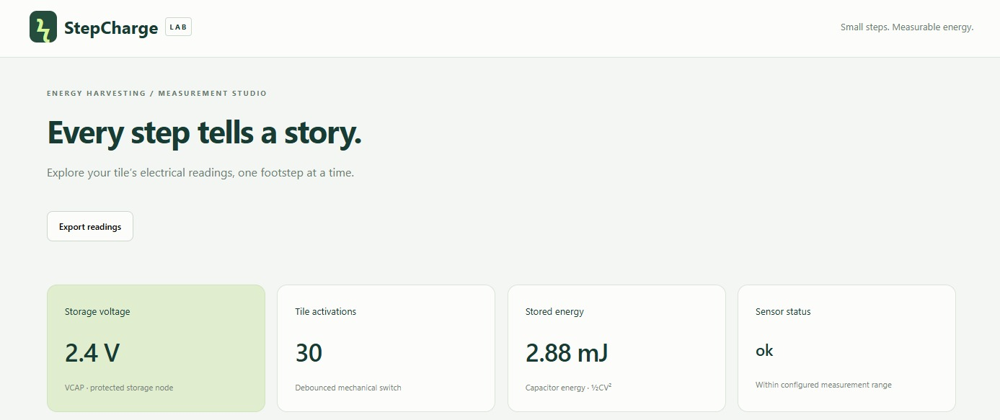
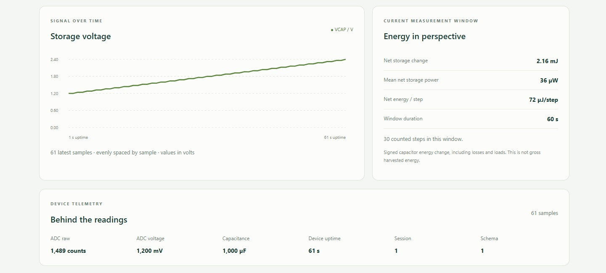
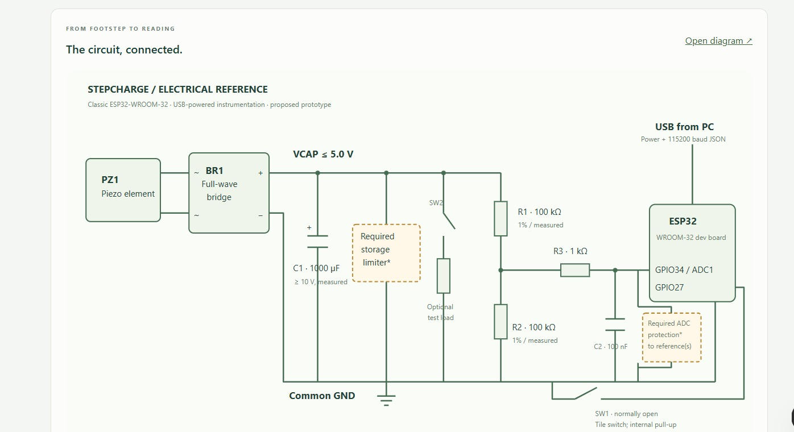

# StepCharge readings app

Open `app/StepCharge.html` in your browser after downloading or cloning the repository. The standalone file includes its styles, JavaScript and circuit diagram. No server or installation is required. GitHub displays HTML source; download the file to run it.

## Final interface

The app shows voltage, tile activations, stored energy, sensor status, a voltage chart, window metrics, device telemetry and the circuit. **Export readings** is the only toolbar action. The source badge, hardware-guide accordion and circuit footnotes are omitted from the interface.

The initial values come from 61 generated samples spanning 60 seconds, not measured hardware performance:

| Reading | Value |
|---|---:|
| Storage voltage | 2.4 V |
| Tile activations | 30 |
| Stored energy | 2.88 mJ |
| Net storage increase | 2.16 mJ |
| Mean net storage power | 36 µW |
| Net energy per activation | 72 µJ/step |
| Capacitance | 1,000 µF |

Export downloads JSON Lines; the generated capture retains `synthetic` in its export filename. The same values are in [the example capture](../examples/demo_readings.jsonl). Analyze an export with `python tools/analyze.py PATH_TO_CAPTURE`.

## Screenshots

Supplied by the project owner on 16 November 2026. These show generated readings, not a physical test.







The circuit screenshot contains asterisks from an earlier rendering. The [current SVG](circuit.svg) is the editable source of truth. Engineering requirements remain in [HARDWARE.md](HARDWARE.md).

## Development

Source files: `app/index.html`, `app/style.css`, `app/app.mjs`, `app/telemetry.mjs`, and `docs/circuit.svg`. With Node.js 20 or newer, rebuild and test after editing:

```sh
node app/build-standalone.mjs
node --test tests/telemetry.test.mjs tests/standalone.test.mjs
```

Optional development server: run `node app/serve.mjs`, then visit `http://localhost:8080/app/`. The modular `index.html` requires HTTP; the standalone `StepCharge.html` works directly. If localhost is unreachable, use the standalone file.

## Acquisition and interpretation

The source retains serial, import, animation, disconnect and new-window handlers, but their controls are hidden by the export-only toolbar rule in `style.css`. Live acquisition is not offered in the final interface. Use `tools/capture.py` for real USB telemetry and `tools/analyze.py` for analysis. Restoring acquisition controls requires editing the source and rebuilding the standalone file.

The retained serial reader targets 115200 baud and Web Serial-capable browsers. USB operation requires physical validation. This is a browser app, with no native mobile or wireless integration.

Analysis preserves negative energy changes and rejects invalid status, changed capacitance, resets and time discontinuities. The chart shows the latest 300 samples evenly spaced by sample index; analysis uses device timestamps. Captures are capped at 20,000 samples and imports at 12 MB. Missing ADC fields display as unavailable.

Stored energy is ½CV². Net storage power is signed capacitor energy change divided by elapsed time. The app does not measure current, battery percentage, gross harvested energy or conversion efficiency.
