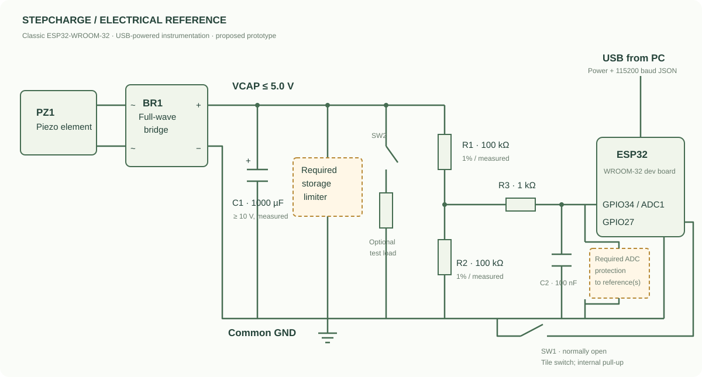

# Hardware architecture and integration

## Design boundary

This is a bench prototype for low-power energy-harvesting experiments. It is not a load-bearing floor product, a phone charger, or a certified battery charger. Use a supported plate, compliant mounting, and mechanical travel stops: brittle ceramic discs must not directly bear a person's weight. Validate the mechanism under controlled applied loads before human stepping.

The classic ESP32 is powered by USB. The harvester supplies only its capacitor and optional test load. Do not connect the capacitor directly to the ESP32's 5 V/VIN or 3V3 supply. No lithium cell is used in the baseline design.

## Proposed bill of materials

| Item | Quantity | Selection requirement |
|---|---:|---|
| ESP32-WROOM-32 development board | 1 | Classic ESP32 with GPIO34 and GPIO27 accessible; USB programming |
| Piezoelectric transducer | 1 initially; expand after tests | Known supplier voltage, displacement, capacitance, and mechanical limits; generic buzzer discs are experimental only |
| Rectifier | 1 per independently loaded transducer | Full-wave bridge; choose reverse voltage above the measured worst-case piezo peak and compare forward loss and leakage at actual current |
| Voltage limiter/protection | 1 circuit | Validated clamp holding the storage node at or below 5.0 V under worst-case pulses; account for clamp tolerance and current-dependent voltage |
| Storage capacitor | 1 | Start around 1000 uF, rated at least 10 V; measure actual capacitance and leakage; polarity correct |
| Divider top resistor | 1 | 100 kOhm, 1% or better; measure resistance |
| Divider bottom resistor | 1 | 100 kOhm, 1% or better; measure resistance |
| ADC filter capacitor | 1 | 100 nF ceramic from ADC node to ground |
| ADC series protection resistor | 1 | 1 kOhm initial value; validate with selected external clamp network |
| ADC external protection | 1 network | Low-leakage protection suited to ESP32 input ratings, including powered-off operation; verify actual clamp voltage |
| Normally-open mechanical switch | 1 | Actuated by tile movement; independent of raw piezo signal |
| Test-load resistor and switch | 1 set | Known resistance and adequate power rating; disconnect during capacitor-only charge trials |
| Plate, compliant mounts, travel stops, base | 1 assembly | Mechanically constrained loading and protected wiring |
| USB data cable, terminal blocks, enclosure | As needed | Strain relief and accessible measurement test points |
| Multimeter, oscilloscope, capacitance meter | Test equipment | Required to verify voltage peaks, divider calibration, capacitance, and ringing |

Do not choose a rectifier solely because it is labelled Schottky: leakage and reverse-voltage capability matter. A nominal 5.1 V Zener is not evidence of a 5.0 V maximum. No exact clamp or transducer is specified because source peak voltage, harvested current, and tile displacement have not been measured.

## Electrical connections

### Circuit reference labels

| Label | Component / role |
|---|---|
| PZ1 | Piezoelectric element, AC source |
| BR1 | Full-wave rectifier bridge |
| C1 | Storage capacitor, nominal 1000 µF; measure actual capacitance |
| R1 / R2 | 100 kΩ top/bottom voltage-divider resistors |
| R3 | 1 kΩ series resistor at the ADC input |
| C2 | 100 nF ADC filter capacitor |
| SW1 | Normally-open tile switch, GPIO27 to GND |
| SW2 | Optional load-disconnect switch |
| VCAP | Protected storage node measured through the divider |

The diagram is a wiring reference, not a PCB layout or a completed protection design. The app embeds this SVG without explanatory footnotes; component-selection and validation requirements remain in this document.



[Open the full-size SVG diagram](circuit.svg). Dashed blocks identify required protection designs whose components have not yet been selected or validated.

```text
Piezo AC leads --> bridge AC terminals
bridge negative ------------------------------- common GND
bridge positive --> protected storage node VCAP
VCAP --> capacitor positive; capacitor negative --> GND
Validated storage limiter: VCAP to GND

VCAP -- 100k (Rtop) -- divider node -- 1k -- GPIO34
                         |                  |
                    100k (Rbottom)         100nF
                         |                  |
                        GND                GND
External ADC clamp/protection at GPIO34: validate for both powered and unpowered ESP32

GPIO27 -- normally-open mechanical switch -- GND
GPIO27 uses the ESP32 internal pull-up; no external voltage is applied.
USB --> ESP32 board; ESP32 GND --> common GND
```

| ESP32 connection | Destination | Requirement |
|---|---|---|
| GPIO34 (ADC1) | Protected divider output | Never raw piezo output; no internal pull-up available on GPIO34 |
| GPIO27 | Switch to GND | Active low, debounced; one activation per press/release |
| GND | Harvester measurement ground | Required voltage reference |
| USB | PC/power source | Instrumentation power and telemetry |

The nominal divider ratio is 2:1, so 5.0 V at VCAP gives approximately 2.5 V at the ADC. With 100 kOhm + 100 kOhm, divider consumption is 25 uA and 125 uW at 5 V: a significant load for a piezo harvester. The filter time constant is approximately 5 ms. These values favor a simple filtered bench measurement, not maximum harvesting efficiency. A high-input-impedance buffer or isolated measurement switch is a later improvement, requiring a revised error and power budget.

ADC attenuation changes measurement range; it does not protect a pin. A series resistor alone is also not protection. Disconnect the harvester measurement lead before powering down the ESP32 unless the selected protection explicitly supports a live input with the board off. Discharge the capacitor through a resistor before rewiring; do not short it with tools.

## Multi-transducer expansion

Begin with one characterized element. For elements stressed at different times or polarity, independently rectify each element before combining DC outputs. Direct AC parallel wiring can cancel signals; series wiring increases voltage stress and does not guarantee more delivered energy. Compare configurations using identical mechanical input and starting capacitor voltage.

## Optional dedicated harvesting IC

The Analog Devices LTC3588-1 is a candidate for a later revision: it integrates a bridge rectifier and buck converter intended for high-impedance harvesting sources. Use its evaluation-board documentation and reference schematic, including specified external components and UVLO behavior. It is not a drop-in substitute for the wiring above, and the ESP32 must not measure a high-voltage reservoir through the baseline 2:1 divider. Any topology change requires a new divider/protection design and calibration.

## Bring-up sequence

1. Check USB-powered firmware and switch counting with the harvester disconnected.
2. Verify the voltage input using a current-limited bench source and multimeter; start below 1 V at VCAP and stop at 5 V.
3. Verify ADC-side protection and source-side limiter with the board powered and unpowered using suitable test equipment.
4. Characterize the piezo/rectifier separately with a voltage-rated oscilloscope probe; measure pulses and reverse voltage.
5. Connect the storage capacitor and verified limiter; check polarity, leakage, and maximum voltage.
6. Connect the measurement divider, then perform the controlled tests in TESTING.md.
